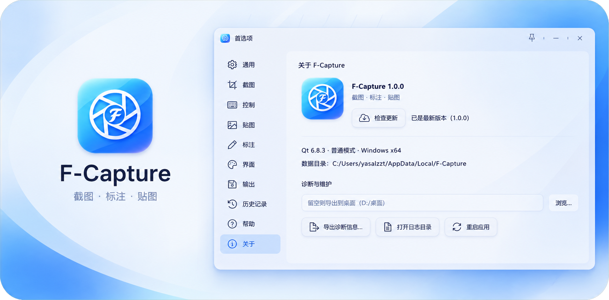
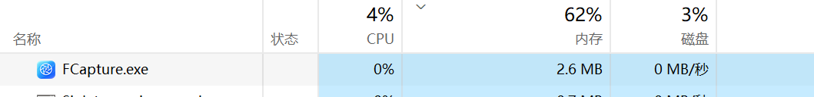
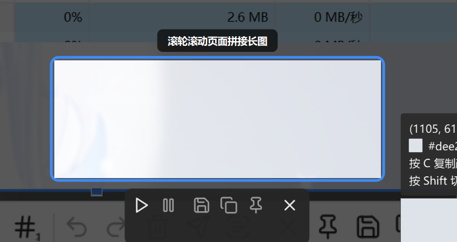
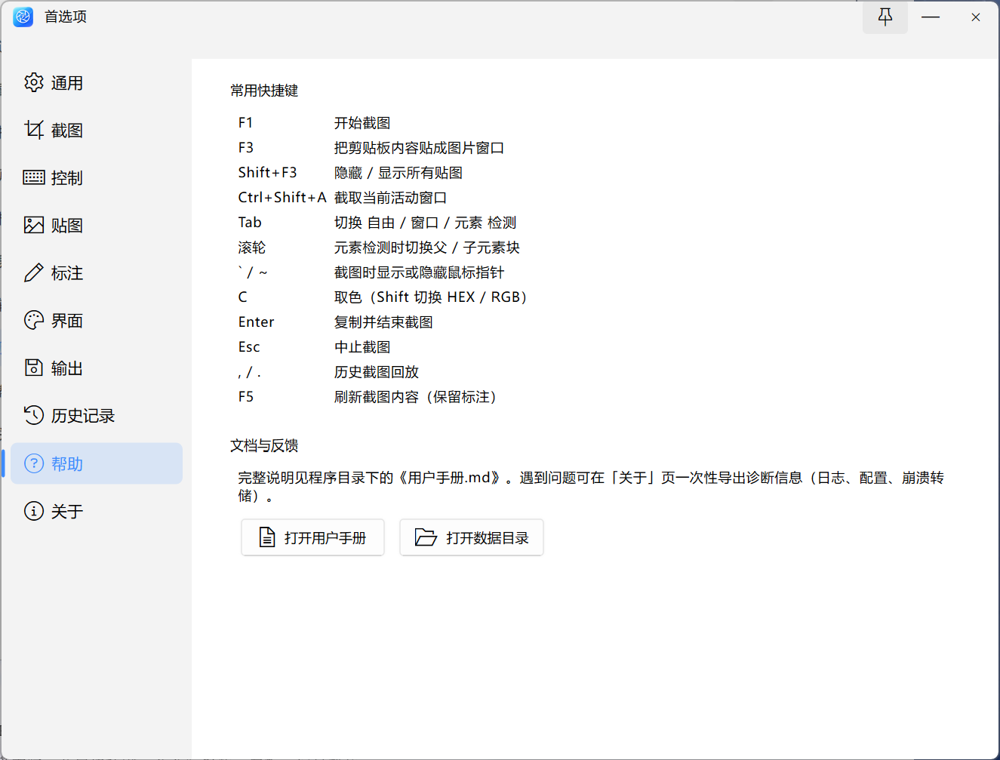
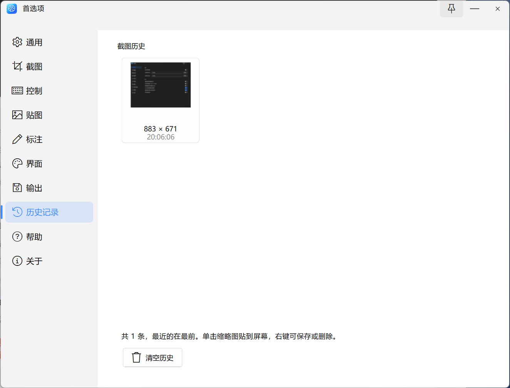
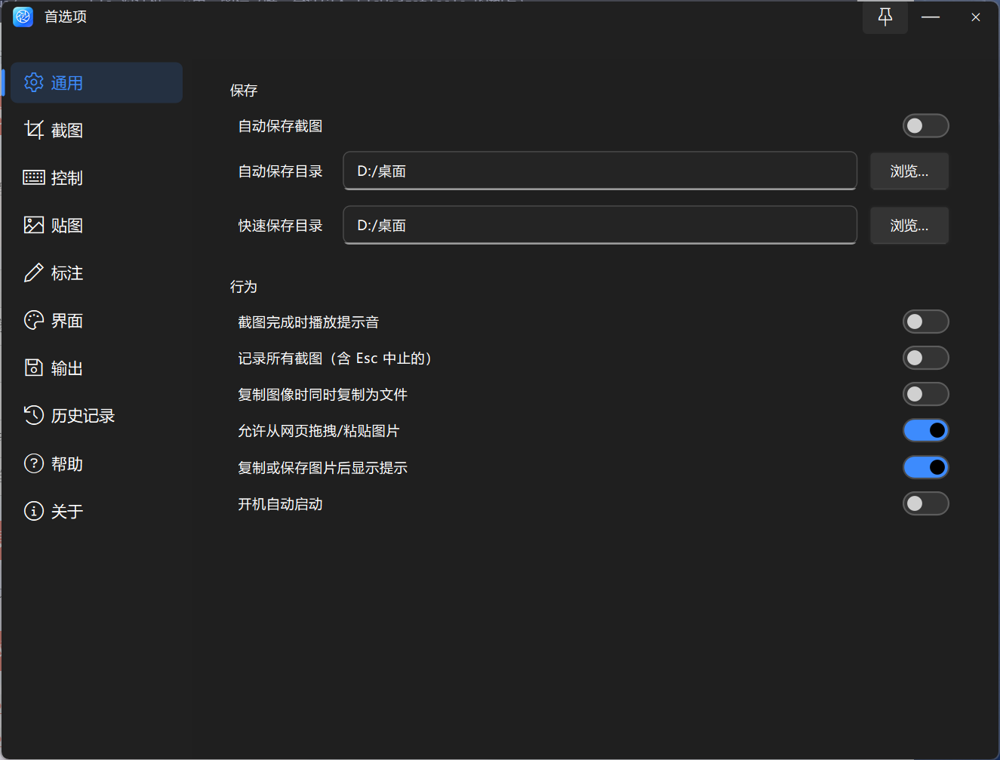

<h1 align="center">F-Capture</h1>

<p align="center">
  
</p>

> 基于 Qt 6 Widgets（C++20）打造的 Windows 截图 · 标注 · 贴图工具，交互上致敬 Snipaste。



## 功能

**截图**

- 区域截图、窗口检测、界面元素检测（UI Automation，能精确识别按钮、输入框等具体控件）
- **滚动长截图**：按 `F2` 框选固定区域后滚动页面，自动拼接成长图；配套独立工具栏（开始 / 暂停 / 保存 / 复制 / 钉 / 关闭）
- 滚轮在「具体控件 ↔ 父容器 ↔ 整窗」之间切换层级，`Alt + 单击` 直接选中整个窗口
- 像素级微调、固定比例、圆角、阴影、延迟截图、历史回放
- 截图可包含鼠标光标（`~` 切换）

**标注**

- 矩形 / 椭圆（空心、实心可选）、直线 / 箭头（含锥形倒刺样式）、折线、铅笔、马克笔
- 文字（6~400px、背景填充、描边）、马赛克、高斯模糊、橡皮擦
- 序号标注、放大镜、套索选择、8 点缩放 + 旋转、标注复制 / 粘贴
- 撤销 / 重做 50 步、自定义调色板（Ela 取色器，支持透明度与 HEX 输入）
- 工具栏收纳为分组下拉：形状、线条、手绘、像素、橡皮擦、序号 / 放大镜 / 套索

**贴图**

- 剪贴板图片 / 文本 / HTML / 颜色 / 文件路径 → 置顶图片窗口
- 缩放、透明度、旋转、镜像、灰度、反色、裁剪
- 分组管理、吸附、鼠标穿透、虚拟桌面支持

**识别与工具**

- **OCR 文字识别**（Windows.Media.Ocr，完全本地、不联网）
- **二维码 / 条码识别**（ZXing-C++，支持 QR、DataMatrix、Aztec 及各类一维码，一图多码）
- 托盘常驻、全局快捷键、命令行参数、白板、屏幕热角

## 硬性要求

| 项 | 值 |
|---|---|
| 系统 | Windows 10 / 11 x64 |
| Qt | **6.8.3 msvc2022_64** |
| 编译器 | **MSVC 2022 x64**（必须；OCR 依赖 C++/WinRT，MinGW 不可用） |
| CMake | ≥ 3.21，使用 **Visual Studio 17 2022** 生成器 |
| ElaWidgetTools | **2.0.2**，默认路径 `D:/cppsoft/MsvcEla` |

## 构建 / 项目结构

```
src/
├── core/          应用控制、配置、日志、热键、诊断、更新检查
├── snip/          截图层（全屏遮罩、选区状态机、绘制、长截图、信息面板）
├── annotate/      标注模型、工具栏、各类形状
├── paste/         贴图窗口与管理器
├── tools/         OCR、白板、热角、文字转图片
├── platform/win/  Win32 / UIA / WinRT / ZXing 封装（唯一允许 include <windows.h> 的地方）
└── ui/            Ela 对话框、菜单、图标（唯一允许引入 ElaWidgetTools 的地方）

third_party/
└── zxing-cpp/     二维码 / 条码解码（仅保留 core 源码）
```

一条命令完成构建与打包：

```bash
./scripts/build.sh          # 构建 + 打包
./scripts/build.sh clean    # 全量重建
```

关键设计约定见 [`docs/00-全局约定.md`](docs/00-全局约定.md)。

## 更新

「首选项 → 关于 → 检查更新」会查询本仓库的 GitHub Releases，比较版本号后提示并可一键下载安装。自动更新会同步 Windows「应用和功能」里显示的版本号。

## 文档

- [`docs/user-guide.md`](docs/user-guide.md) —— 用户手册（功能、快捷键、命令行、配置项）
- [`docs/00-全局约定.md`](docs/00-全局约定.md) —— 开发约定（硬约束、编码规范、踩过的坑）

## 亮点

### 极致的内存占用

常驻托盘时内存占用仅约 2.6 MB；截图会话结束后，全屏快照（多屏可达数十 MB）立即释放。



### 滚动长截图

框选区域后滚动页面即可自动拼接，支持暂停续接、上下回滚去重、实时进度提示。



### 文字识别 / 二维码识别 / 序号标注

OCR 完全本地运行；二维码支持一图多码，识别结果可复制，内容为网址时可直接打开。截图会话在识别成功后自动结束，只保留结果窗口。


### 便携模式

> 默认使用系统标准路径存储配置与日志；在 exe 同目录放置 `portable.txt` 即进入便携模式，所有数据改存于 `data/` 子目录，系统盘零残留（便携模式下开机自启被禁用，因为需要写注册表）。

| 项       | 普通模式                            | 便携模式                           |
| -------- | ----------------------------------- | ---------------------------------- |
| 触发条件 | 默认                                | exe 同目录存在 portable.txt        |
| 配置     | %LOCALAPPDATA%/F-Capture/config.ini | <exe目录>/data/config.ini          |
| 日志     | %LOCALAPPDATA%/F-Capture/log/       | <exe目录>/data/log/                |
| 崩溃转储 | %LOCALAPPDATA%/F-Capture/crash/     | <exe目录>/data/crash/              |
| 开机自启 | 可用（写注册表）                    | 禁用（注册表会留痕，破坏便携语义） |

### 快捷键自定义

所有热键均可在首选项里重新绑定，托盘菜单与悬停提示会同步显示当前绑定。



### 历史截图

随时回看最近的截图记录，会话结束立即释放内存。



### 提示音 / 操作提醒 / 明暗主题



## 许可

本仓库仅用于学习与个人使用。
